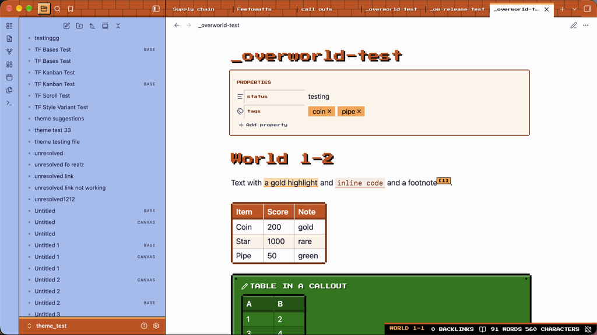
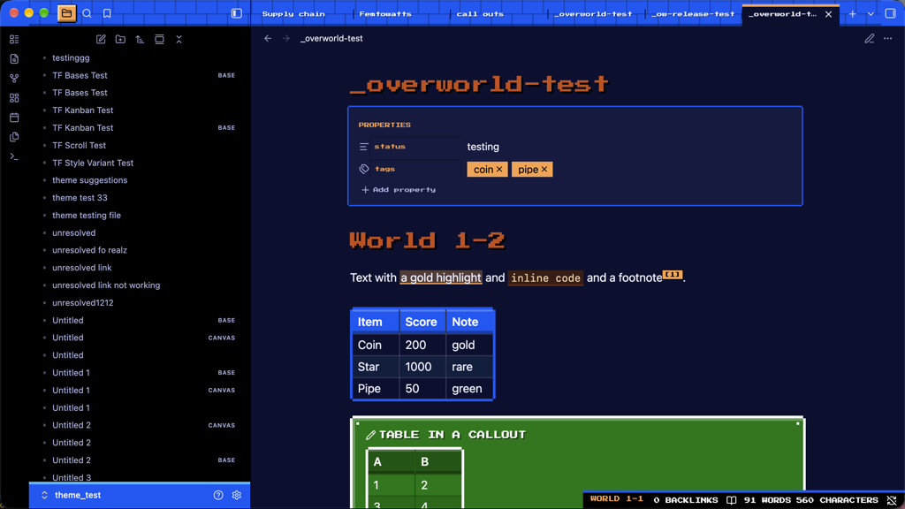
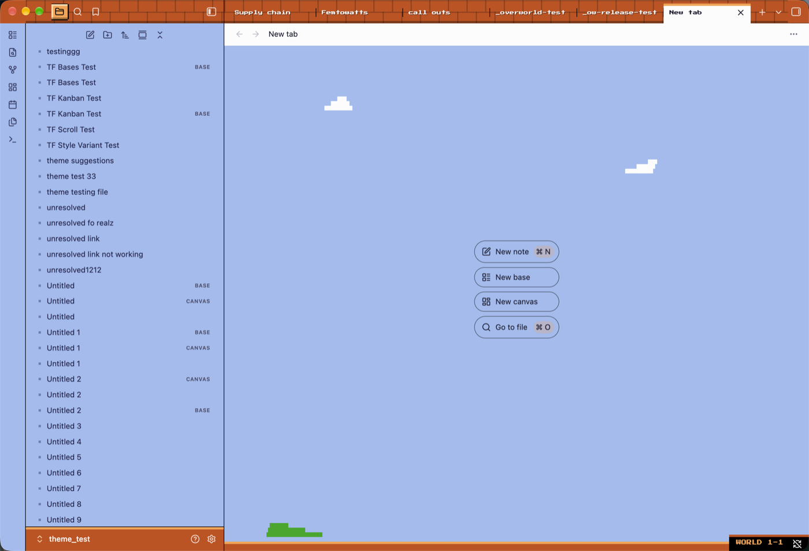
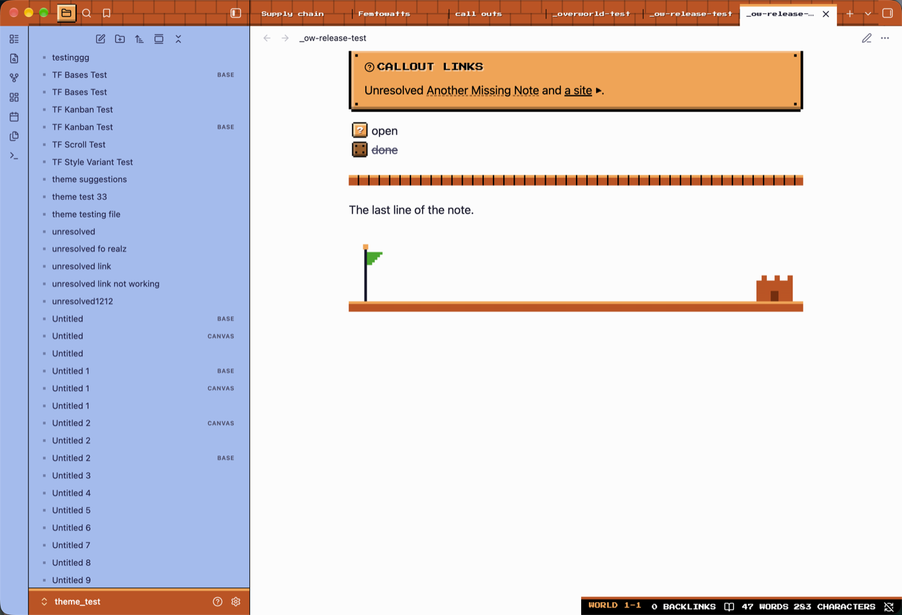

# Overworld

An 8-bit platformer theme for Obsidian. Brick chrome, pipe-green quotes, coin tags, question-block checkboxes and a pixel font for headings. Light and dark.

Every shape is drawn with CSS gradients and stepped box shadows. There are no images and no third-party sprites or logos.

| Light | Dark |
|---|---|
|  |  |

| Empty tab | Flagpole option |
|---|---|
|  |  |

## What it changes

- Headings in Press Start 2P with a hard title shadow
- Callouts as framed blocks: gold, lava, 1-UP green, pipe green, underground blue, used-block brown
- Checkboxes: a question block that turns into a used block when checked
- Tags as coins, highlights as a coin-gold marker, footnotes as coins
- Blockquotes as standing pipes
- Tables with a ground-block header and zebra rows
- Sidebar with menu-cursor rows, brick folder blocks and file pips
- Status bar as a HUD, with a "WORLD 1-1" label
- Settings, command palette and modals as title-card boxes
- Unresolved links in used-block brown, external links with a pixel arrow
- New-tab screen with clouds, a hill and a ground strip

## Options

Install the [Style Settings](https://github.com/obsidian-community/obsidian-style-settings) plugin to get these toggles. All are off by default.

| Option | Effect |
|---|---|
| Motion | Coin flash on jumps, pointer blink, checkbox bump, button press. Respects reduced-motion. |
| Plain table rows | Turns off zebra striping |
| Table headers in body font | Table headers use the normal font |
| Tab titles in body font | Tab titles use the normal font |
| Hide HUD label | Removes the "WORLD 1-1" label from the status bar |
| Quiet folder tiles | Folder chevrons sit on a faint tile instead of a brick block |
| Flagpole at note end | Pixel flagpole and castle under the last line in reading view |

## Install

Settings, Appearance, Themes, Manage, search for Overworld.

To install by hand, put `theme.css` and `manifest.json` in `.obsidian/themes/Overworld/` in your vault.

## Credits

Font: [Press Start 2P](https://github.com/codeman38/PressStart2P), SIL Open Font License 1.1, latin subset embedded in `theme.css`.

Licensed under MIT. See `LICENSE`.
